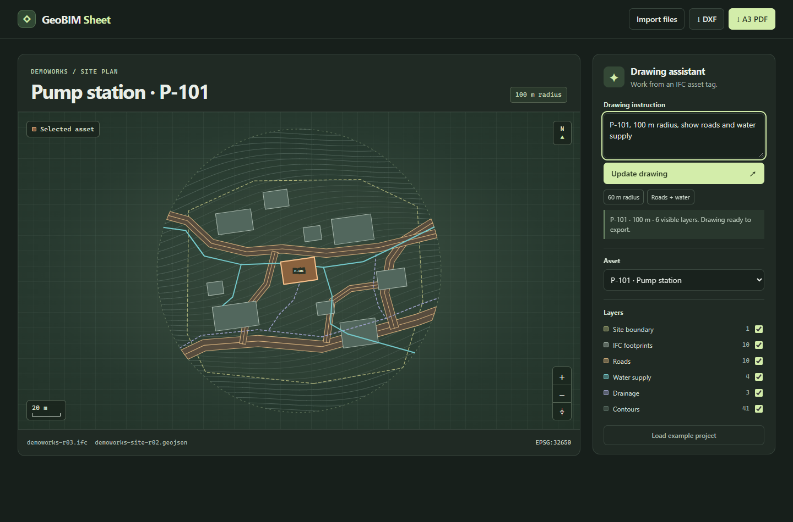

# GeoBIM Sheet & Revision Review Agent

GeoBIM Sheet is an open-source, self-hostable **GIS/BIM drawing workspace and design revision review agent**. Compare two IFC4/IFC4.3 design revisions against GIS site utility layers, verify coordinate reference systems, detect moved assets (including GlobalId changes on re-export), calculate planar clearances to water/drainage pipelines (flagging missing bury depth as `待核实高程`), and export traceable **A3 comparison PDFs**, **UTF-8 CSV issue registers**, and **editable 2D DXF drawings**.

All geometric calculations, CRS checks, distance queries, and drawing exports are executed deterministically by shared Python tools—exposed through both an **official Python MCP stdio server** and a **Flask Web Agent UI** with real tool-calling LLM support (local **Ollama** or any **OpenAI-compatible** API).



> 中文快速上手请查看：[docs/QUICKSTART_ZH.md](docs/QUICKSTART_ZH.md) · 测试说明：[docs/TESTING.md](docs/TESTING.md)

## Features

- **Classic Drawing Workspace (`/`)**: Pick an IFC asset, crop surrounding GIS layers by radius, and export A3 PDF or full-scale projected-CRS DXF.
- **Revision Review Agent (`/agent`) — v0.3 Mining & Industrial Edition**:
  - Built-in **CGCS2000 (`EPSG:4547`) Mineworks Concentrator** scenarios (`mineworks`, `mineworks_dxf`, `mineworks_dup`) alongside generic site scenarios (`normal`, `id_changed`, `duplicate_pumps`, `missing_crs`).
  - Direct **CAD `.dxf` utility layer ingestion** in projected CRS metres (auto-mapping `WATER`, `SLURRY`, `POWER`, `DRAINAGE`, `SLOPE`, `ROADS`, `BOUNDARY`) in addition to WGS 84 GeoJSON.
  - **Two-step explicit georeferencing (`georeference_project`)**: when an IFC lacks `IfcMapConversion`, reports exact missing fields and allows explicit EPSG CRS + origin/rotation override without guessing.
  - **Mining/industrial clearance rules (`geobim_sheet/rules.py`)**: checks water, slurry/tailings, power cable trenches, flood drainage ditches, and bench slopes against configurable minimum horizontal clearances, flagging violations and marking missing bury depth as `待核实高程`.
  - Compares two IFC revisions prioritizing IFC `GlobalId`; when `GlobalId` changes on re-export, proposes candidate matches by unique `Tag` + `IfcClass` with rationale, or returns ambiguous candidates for confirmation.
  - Handles duplicate asset names (e.g., two pump houses `SP-101` / `SP-102` or `P-101` / `P-102`): pauses, persists task state and pending question, lists candidates with tags, and resumes from the saved state once the engineer chooses.
  - Full traceability to `project_id`, Rev A / Rev B filenames, IFC `GlobalId`, `Tag`, GIS/DXF source file, layer, utility ID, rule code, and EPSG CRS.
  - Download links appear **only after generated files are verified on disk**.
- **Shared Tool Layer (`geobim_sheet/tools.py`)**:
  - `open_project`, `georeference_project`, `find_assets`, `list_layers`, `compare_revisions`, `check_utility_proximity`, `export_review_package`
- **Dual Entrypoints**:
  1. **Official Python MCP SDK stdio server** (`python -m geobim_sheet.mcp_server`)
  2. **Flask Web UI** (`http://127.0.0.1:8765` and `http://127.0.0.1:8765/agent`)

## Quick Start (Local Python)

Use 64-bit Python 3.11, 3.12, or 3.13:

```powershell
# Windows PowerShell
python -m venv .venv
.\.venv\Scripts\python.exe -m pip install -e .
.\.venv\Scripts\python.exe -m geobim_sheet
```

```sh
# macOS / Linux
python3 -m venv .venv
.venv/bin/python -m pip install -e .
.venv/bin/python -m geobim_sheet
```

Open:
- Drawing workspace: `http://127.0.0.1:8765/`
- Revision Review Agent: `http://127.0.0.1:8765/agent`

## Connect Real Models (Ollama / Cloud LLMs)

Copy `.env.example` to `.env` (never put API keys in frontend code):

```sh
# Local Ollama (tool-calling model such as qwen2.5:7b / qwen3:8b / llama3.1:8b)
LLM_PROVIDER=ollama
LLM_BASE_URL=http://127.0.0.1:11434
LLM_MODEL=qwen2.5:7b
```

```sh
# OpenAI-compatible Cloud API (OpenAI / Google Gemini / DeepSeek / DashScope / vLLM)
LLM_PROVIDER=openai
LLM_BASE_URL=https://api.openai.com/v1
LLM_MODEL=gpt-4o-mini
LLM_API_KEY=sk-...
```

If no LLM environment variable is configured (`LLM_PROVIDER=demo`), the Web Agent runs the synthetic/self-hosted workflow with a deterministic demo tool planner that executes the exact same 6 Python tools.

## MCP Server (Local stdio) & Codex Integration

Start the MCP server directly:

```sh
python -m geobim_sheet.mcp_server
```

Add to Codex (`~/.codex/config.toml`, see also [docs/codex-mcp.toml](docs/codex-mcp.toml)):

```toml
[mcp_servers.geobim-sheet]
command = "python"
args = ["-m", "geobim_sheet.mcp_server"]
cwd = "/path/to/geobim-sheet"

[mcp_servers.geobim-sheet.env]
GEOBIM_DATA_DIR = "/path/to/geobim-sheet/data/geobim_review"
```

### Copyable Demo Prompt for Codex / MCP Client

```text
请使用 geobim-sheet MCP 工具打开内置合成场景 preset="normal"（也可以试 preset="duplicate_pumps" 或 preset="id_changed"），对比这两版设计，找出位置变动的设备。检查泵房附近有哪些给水管线需要复核，生成一张前后对照图和一份问题清单，并告诉我实际生成的文件路径和缺失高程的管线。
```

## Deploy with Docker Compose (Self-Hosted & Public Demo)

```sh
cp .env.example .env
docker compose up --build -d
```

- **Public demo mode**: set `GEOBIM_ALLOW_UPLOAD=false` in `.env` so visitors use the bundled synthetic Demoworks scenarios safely.
- **Self-hosted mode**: keep `GEOBIM_ALLOW_UPLOAD=true` to upload your own Rev A `.ifc`, Rev B `.ifc`, and WGS 84 `.geojson` files.
- **With local Ollama container**: `docker compose --profile ollama up -d`, pull a tool-calling model (`docker exec -it geobim-ollama ollama pull qwen2.5:7b`), and set `LLM_PROVIDER=ollama` + `LLM_BASE_URL=http://ollama:11434`.

### Deploy to Google Cloud Run (Optional)

The `Dockerfile` binds `0.0.0.0:$PORT` out of the box:

```sh
gcloud run deploy geobim-sheet \
  --source . \
  --region asia-east1 \
  --allow-unauthenticated \
  --set-env-vars GEOBIM_ALLOW_UPLOAD=false,LLM_PROVIDER=demo
```

## Synthetic Fixtures & Testing

Regenerate all synthetic fixtures (`demoworks-r03.ifc`, `demoworks-rev-a.ifc`, `demoworks-rev-b.ifc`, `demoworks-rev-b-id-changed.ifc`, `demoworks-dup-rev-a/b.ifc`, `demoworks-no-crs.ifc`, `demoworks-utilities.geojson`):

```sh
python geobim_sheet/demo/make_demo.py
```

Run the full automated test suite (baseline workspace + 6 review tools + Web Agent API + MCP stdio integration + mock LLM tool-calling HTTP protocol):

```sh
python -m unittest discover -s tests -v
```

See [docs/TESTING.md](docs/TESTING.md) for automated vs. real-LLM end-to-end verification instructions.

Licensed under [MIT](LICENSE).
