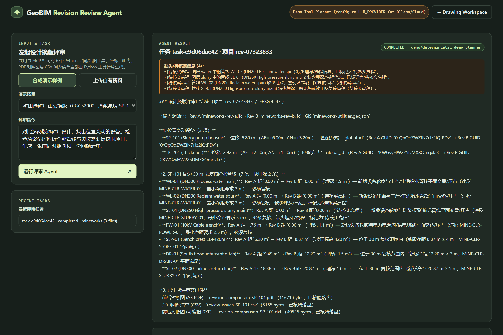
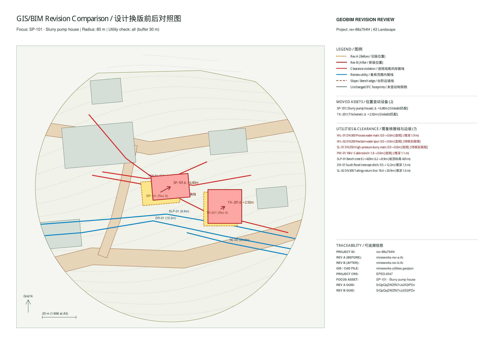

# GeoBIM Sheet 设计换版评审 Agent 快速上手（中文）

> **在线公开试玩**：[矿山/工业设计换版评审 Agent (`/agent`)](http://1.92.125.135/agent) · [经典制图工作台 (`/`)](http://1.92.125.135/)（公开演示实例关闭上传，仅运行内置 7 组合成场景）

本项目在原有 GeoBIM Sheet（IFC + GIS 局部出图工作台）基础上，新增了面向**矿山与工业场地**的 **GIS/BIM 设计换版评审 Agent**，提供 **MCP（本地 stdio）** 和 **Flask 网页（`/agent`）** 双入口，共用同一套可独立测试的确定性 Python 空间与出图工具。





## 1. 环境准备与本地启动

需要 64 位 Python 3.11 / 3.12 / 3.13：

```powershell
# Windows PowerShell
git clone https://github.com/sunchuang185-pixel/geobim-sheet.git
cd geobim-sheet
python -m venv .venv
.\.venv\Scripts\python.exe -m pip install -e .
.\.venv\Scripts\python.exe -m geobim_sheet
```

启动后访问：
- 原有制图工作台：`http://127.0.0.1:8765/`
- 设计换版评审 Agent：`http://127.0.0.1:8765/agent`

## 2. 体验 7 个内置合成评审场景（v0.3 新增矿山选矿厂版）

下拉框可直接切换 7 组内置合成样例：
1. **矿山选矿厂正常换版 (`mineworks`)**：采用国内矿山常用的 **CGCS2000 3°带 (`EPSG:4547`)**，渣浆泵房 `SP-101` 位移约 `6.80 m`，自动按矿山净距规则核查矿浆管 `SL-01`（缺埋深标 `待核实高程`）、生产回水 `WL-01/WL-02`、电缆沟 `PW-01`、截洪沟 `DR-01` 与南侧台阶边坡线 `SLP-01`。
2. **矿山选矿厂 DXF 管网直读 (`mineworks_dxf`)**：直接读取投影米制 CAD `.dxf` 管网总图（自动识别图层和文本标注中的位号与埋深）。
3. **矿山同名设备 (`mineworks_dup`)**：存在两座同名渣浆泵房（`SP-101` 与 `SP-102`），暂停反问并由用户点选后继续原任务。
4. **通用厂区正常换版 (`normal`)**：泵房 `P-101` 位移约 `7.66 m`，给水管线 `WL-02`/`WL-03` 缺埋深标 `待核实高程`。
5. **ID 变化 (`id_changed`)**：`P-101` 重导出后 IFC `GlobalId` 改变，按唯一位号 `Tag` + `IfcClass` 提出候选匹配并给出依据。
6. **同名设备 (`duplicate_pumps`)**：两个 `Pump station`（`P-101` / `P-102`）暂停反问并续跑。
7. **坐标缺失 (`missing_crs`)**：Rev B 缺少 `IfcMapConversion`，明确列出缺失项；支持在上传面板或通过 `georeference_project` 工具填入 `EPSG:4547` + 原点坐标完成显式配准。

自托管部署时，点击「上传自有资料」可导入两版 `.ifc` 模型 + `.geojson` 或 **`.dxf`** 管网总图，并可选填投影坐标配准参数。

## 3. 接入真实大模型（本地 Ollama / 云端模型）

复制 `.env.example` 为 `.env`（所有密钥仅在服务端通过环境变量配置，绝不暴露给前端）：

### 本地 Ollama

```env
LLM_PROVIDER=ollama
LLM_BASE_URL=http://127.0.0.1:11434
LLM_MODEL=qwen2.5:7b
```

确保已拉取支持 Tool Calling 的模型（如 `ollama pull qwen2.5:7b` 或 `qwen3:8b`）。

### 云端 OpenAI 兼容接口（OpenAI / Gemini / DeepSeek / 通义千问等）

```env
LLM_PROVIDER=openai
LLM_BASE_URL=https://generativelanguage.googleapis.com/v1beta/openai
LLM_MODEL=gemini-2.5-flash
LLM_API_KEY=你的服务端Key
```

## 4. MCP 接入（Codex 示例）

在 `~/.codex/config.toml` 中加入（完整模板见 `docs/codex-mcp.toml`）：

```toml
[mcp_servers.geobim-sheet]
command = "python"
args = ["-m", "geobim_sheet.mcp_server"]
cwd = "/path/to/geobim-sheet"

[mcp_servers.geobim-sheet.env]
GEOBIM_DATA_DIR = "/path/to/geobim-sheet/data/geobim_review"
```

### 可直接复制的演示指令

```text
请调用 geobim-sheet MCP 工具打开 preset="normal" 项目，对比这两版设计找出位置变动的设备，检查泵房附近有哪些给水管线需要复核，生成一张前后对照图和一份问题清单，并列出缺失高程的管线及生成的文件路径。
```

## 5. Docker Compose 部署

```bash
cp .env.example .env
docker compose up --build -d
```

- 公开演示模式：在 `.env` 中设置 `GEOBIM_ALLOW_UPLOAD=false`
- 自托管模式：保持 `GEOBIM_ALLOW_UPLOAD=true`
- 附带本地 Ollama 容器：`docker compose --profile ollama up -d`

## 6. 运行测试

```powershell
python -m unittest discover -s tests -v
```
